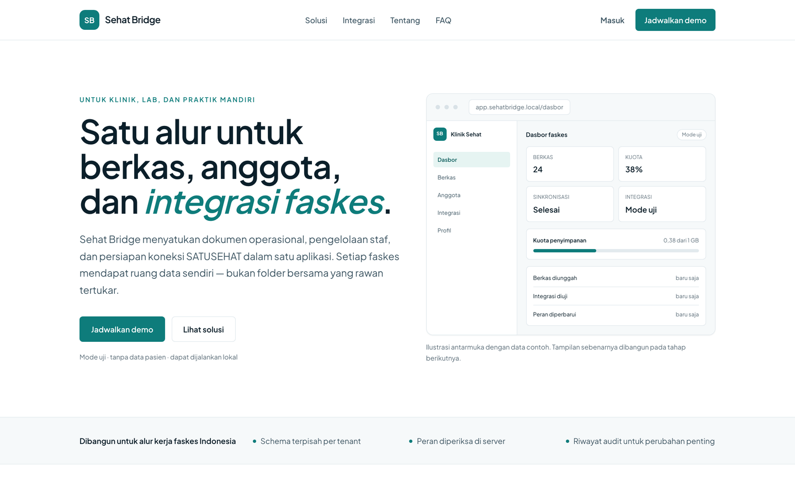
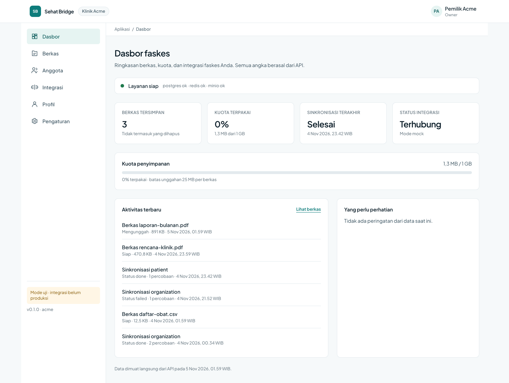
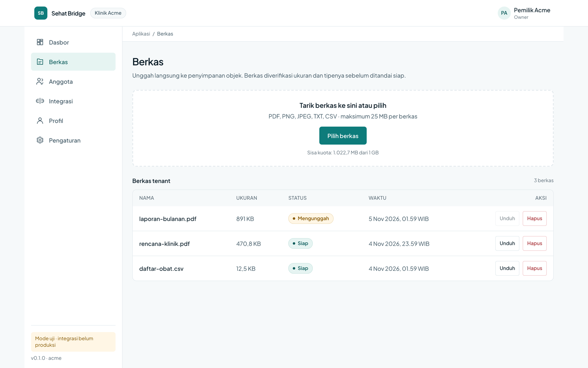
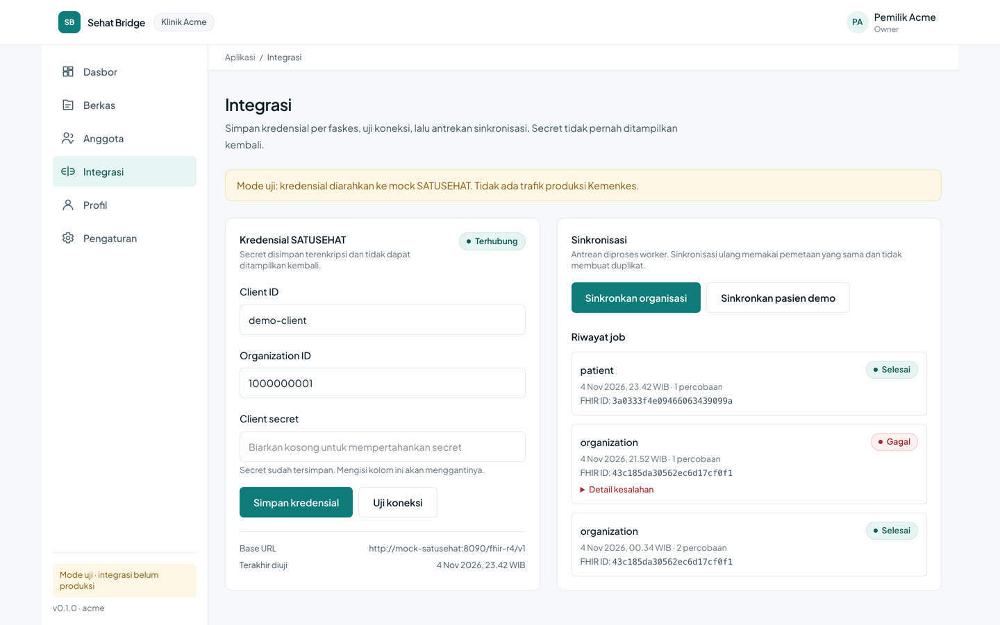
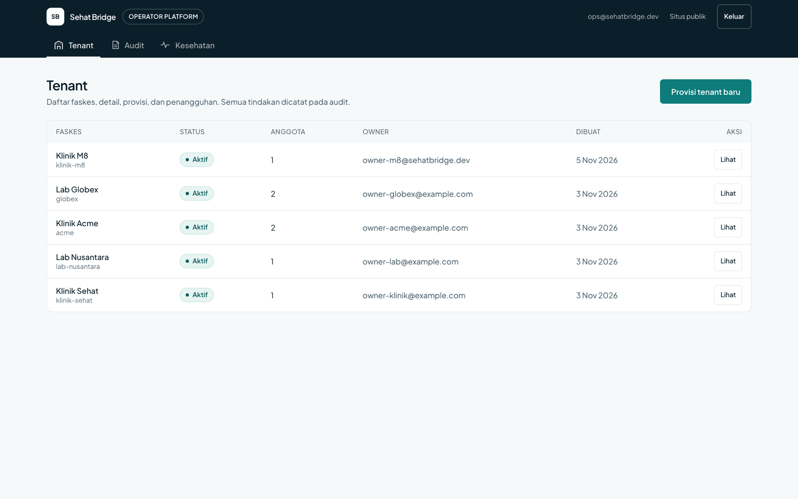
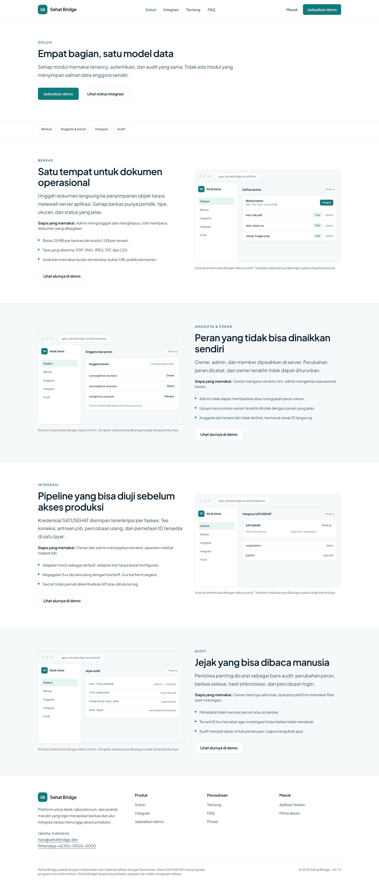
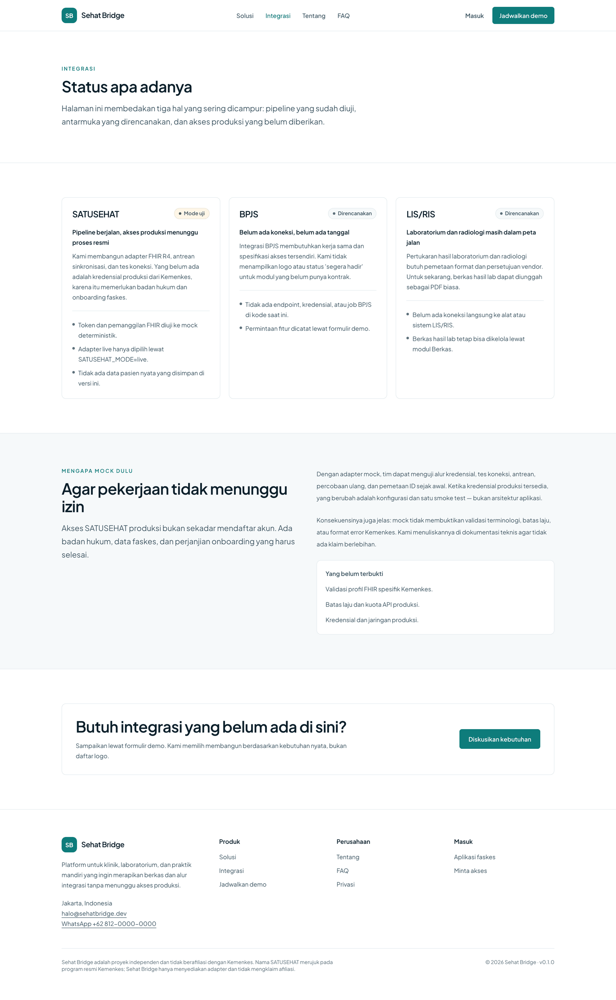
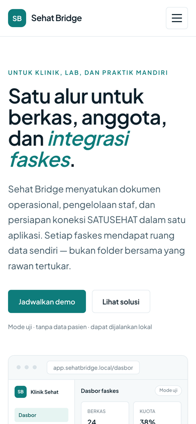

# Sehat Bridge

**Multi-tenant platform for Indonesian health facilities** — files, members,
roles, and SATUSEHAT integration in one flow.

**English** · [Bahasa Indonesia](README.md)

[](https://github.com/Harisalghifary/sehat-bridge/actions/workflows/ci.yml)




> Sehat Bridge is an independent project and is **not affiliated with Kemenkes**
> (the Indonesian Ministry of Health). The SATUSEHAT integration runs in test
> mode against a mock adapter. There is no production Kemenkes traffic and no
> patient data is stored.

## Who it is for

Small clinics and laboratories that manage operational files, team members, and
SATUSEHAT integration without building an internal system of their own. One
tenant is one facility; roles (`owner`, `admin`, `member`) bound both data and
actions. The platform operator runs tenants from a console without SQL.

## Screenshots

<table>
  <tr>
    <td width="50%"><br><sub>Facility dashboard</sub></td>
    <td width="50%"><br><sub>Direct-to-object-storage upload</sub></td>
  </tr>
  <tr>
    <td width="50%"><br><sub>SATUSEHAT integration (test mode)</sub></td>
    <td width="50%"><br><sub>Platform operator console</sub></td>
  </tr>
</table>

<table>
  <tr>
    <td width="50%"><br><sub>Available modules</sub></td>
    <td width="50%"><br><sub>Integration status, stated plainly</sub></td>
  </tr>
</table>



## Architecture at a glance

- **One origin through Caddy**, so session cookies are first-party and there is
  no CORS between the app and the API.
- **Tenant comes from the JWT `tid` claim**, never from a spoofable header.
  Schema per tenant, `SET LOCAL search_path`, and RLS as a second layer.
- **Tokens never reach the browser.** Next.js keeps the session in Redis and
  calls the API from the server; only `__Host-*` cookies reach the client.
- **SATUSEHAT goes through `SatusehatPort`**, with the mock as the default; live
  mode is a configuration change, not a code change.

```
Browser ── Caddy ── Next.js (marketing + BFF + app + ops)
                        │
                        ├── FastAPI ── Postgres (public + tenant schemas)
                        │              Redis (sessions, cache, idempotency)
                        │              MinIO (files)
                        └── worker ─── mock / live SATUSEHAT
```

## Quickstart

```bash
git clone git@github.com/Harisalghifary/sehat-bridge.git
cd sehat-bridge
cp .env.example .env
make up
make migrate
make seed
make demo
```

Open <http://localhost:8080>. The operator console is at `/ops/masuk`.

| Account | Tenant | Password |
|---|---|---|
| `owner-acme@example.com` | acme (owner) | `demo-password-123` |
| `same@person.dev` | acme (admin) / globex (member) | `demo-password-123` |
| `ops@sehatbridge.dev` | platform (no tenant) | `demo-password-123` |

`make demo` exercises the product claims end-to-end and prints one
`[ok]`/`[fail]` line per claim. Details: `docs/quickstart.md`.

## What is included

- **Public site** — home, solutions, integration, demo, about, FAQ, privacy, and
  a lead form with honeypot/timing/rate-limit checks.
- **Facility app** — dashboard, presigned upload with progress, members and
  roles, SATUSEHAT integration, profile, settings.
- **Operator console** — tenant list/detail, provisioning with a timeline,
  suspend/resume, cross-tenant audit, dependency and queue health.
- **Hardening** — idempotency keys, a request id in every log line and error,
  Prometheus metrics, optional OTLP tracing, audit/lead retention, email
  verification and password reset through Mailpit.

## API

| Method | Path | Notes |
|---|---|---|
| GET | `/api/v1/health/live` | liveness |
| GET | `/api/v1/health/ready` | postgres, redis, minio |
| POST | `/api/v1/auth/login` | tenant login, access + refresh tokens |
| GET | `/api/v1/users/me` | user, membership, profile |
| POST | `/api/v1/files/presign-upload` | quota reservation + presigned POST |
| POST | `/api/v1/integrations/satusehat/sync` | enqueue a sync |
| GET | `/api/v1/admin/tenants` | operator: list tenants |
| GET | `/api/v1/metrics` | Prometheus |
| GET | `/api/docs` | Swagger UI |

Full contract: `docs/api.md` (generated from OpenAPI) and `docs/04-api-spec.md`.

## SATUSEHAT: mock vs live

Default is `SATUSEHAT_MODE=mock`. The mock adapter issues OAuth2 tokens and
returns deterministic FHIR `Organization`/`Patient` responses, with failure
injection through `?fail=500|4xx|timeout`. `live` mode uses client credentials
and the Kemenkes endpoints, but **has not been verified against production
traffic**. See `docs/satusehat.md` for the limits that remain unproven.

## Security model

1. `tid` from the JWT is the tenant authority; `X-Tenant-ID` is only a hint and
   must match.
2. Non-owner DB role + `FORCE ROW LEVEL SECURITY`; a query without
   `app.tenant_id` returns zero rows.
3. Access tokens last 15 minutes; refresh tokens are opaque, rotated, and reuse
   revokes the entire family.
4. Integration secrets are encrypted with a key separate from the JWT signing
   key; the API only returns `has_secret`.
5. Cookies are `HttpOnly`, `Secure`, `SameSite=Lax`; tokens never appear in
   HTML, JS, localStorage, or logs.

## Status

**v0.1.0** — M0 through M10 complete. Mock SATUSEHAT, no clinical data, and
Compose as the deployment target. The next roadmap lives in
`docs/00-handoff.md`.

## Development

```bash
make test               # pytest + eslint + tsc
make test-integration   # Postgres, Redis, MinIO, mock SATUSEHAT
make lint               # ruff + mypy + eslint + tsc
make smoke              # acceptance checks
make screenshots        # regenerate docs/screenshots
make retention          # audit/lead retention
make restore-drill TENANT=acme
```

## Documentation

| Document | Contents |
|---|---|
| `docs/quickstart.md` | running the stack in two minutes |
| `docs/api.md` | endpoint reference from OpenAPI |
| `docs/04-api-spec.md` | contract, error codes, rate limits |
| `docs/02-architecture.md` | components, request lifecycle, sessions |
| `docs/03-data-model.md` | public/tenant schemas, RLS |
| `docs/runbook.md` | key rotation, restore, stuck jobs |
| `docs/design-review.md` | decisions against the source documents |
| `docs/release.md` | v0.1.0 tag checklist |
| `docs/09-readme-and-demo.md` | screenshots and demo |

MIT — see `LICENSE`.