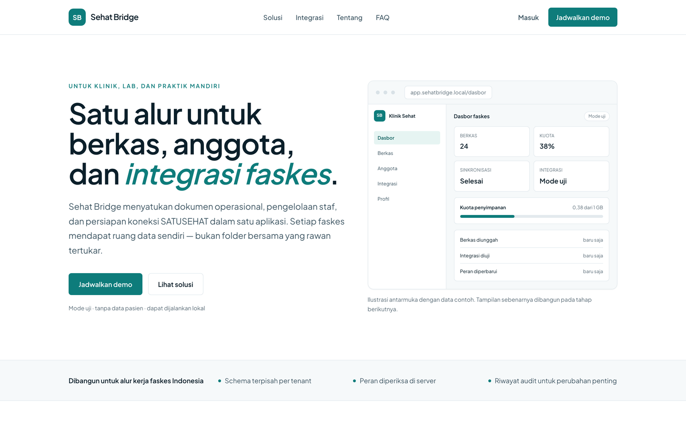
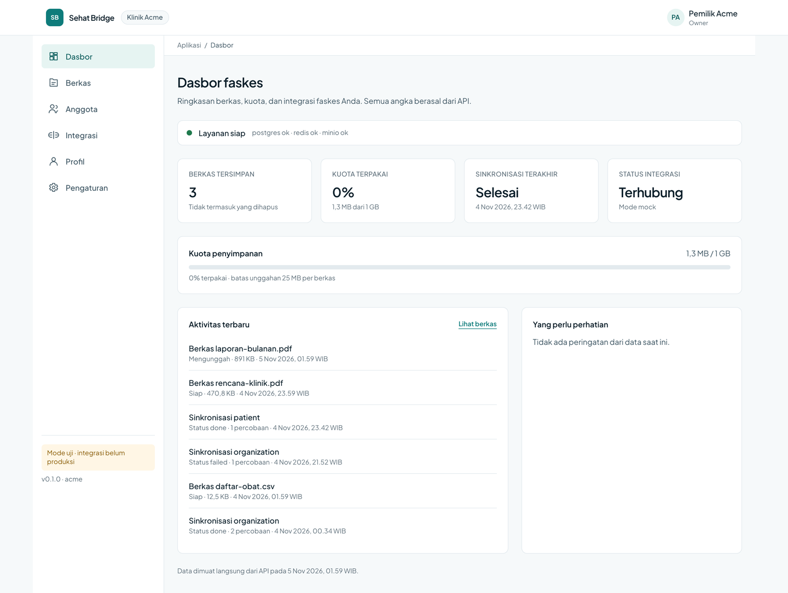
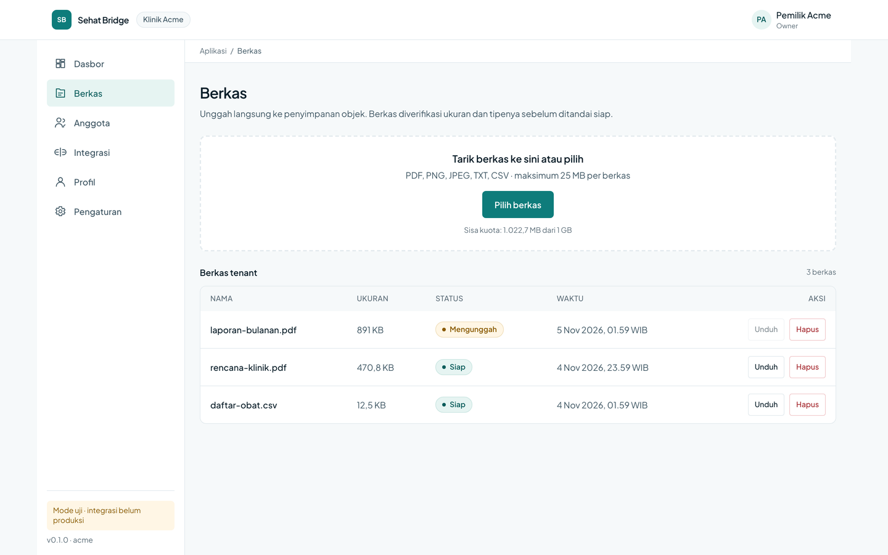
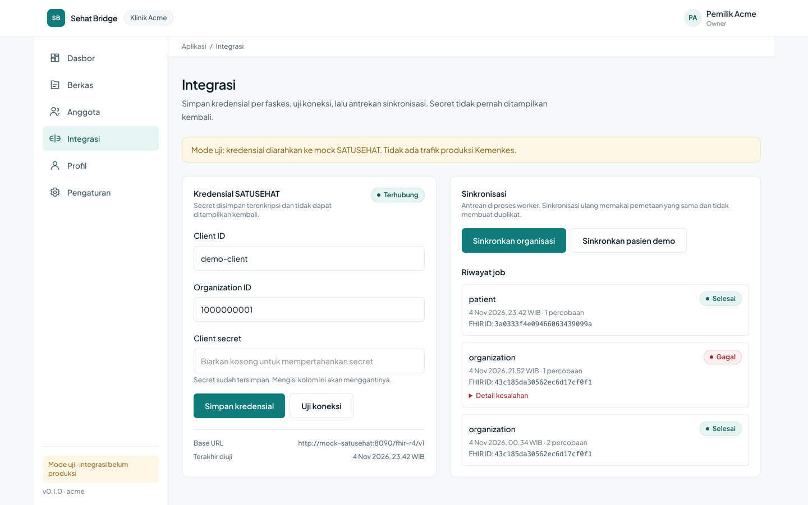
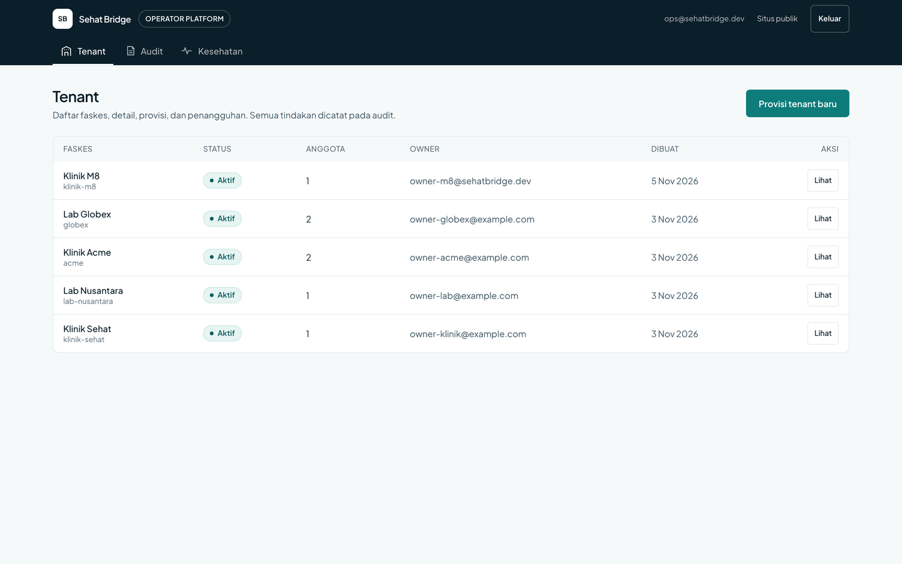
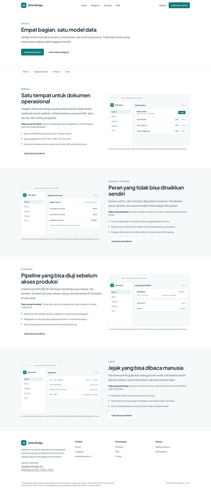
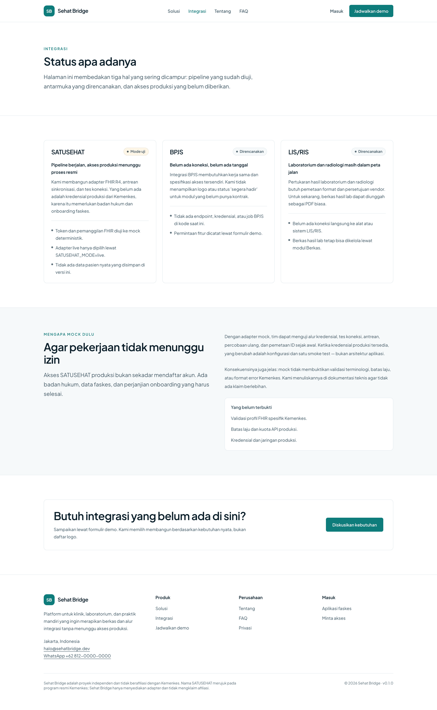
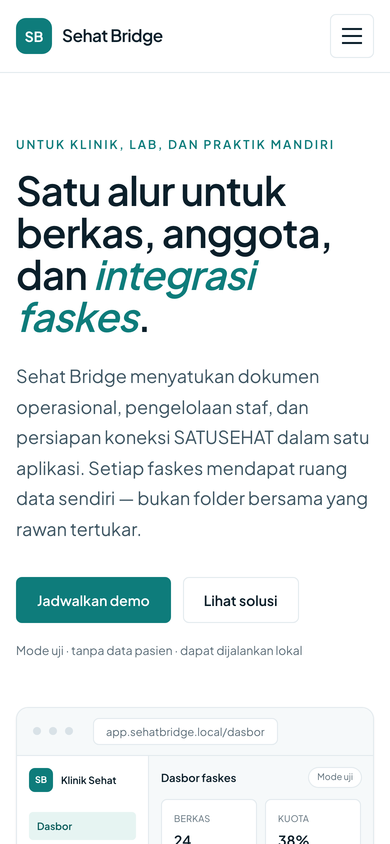

# Sehat Bridge

**Platform multi-tenant untuk fasilitas kesehatan Indonesia** — berkas, anggota,
peran, dan integrasi SATUSEHAT dalam satu alur.

**Bahasa Indonesia** · [English](README.en.md)

[](https://github.com/Harisalghifary/sehat-bridge/actions/workflows/ci.yml)




> Sehat Bridge adalah proyek independen dan **tidak berafiliasi dengan Kemenkes**.
> Integrasi SATUSEHAT berjalan dalam mode uji dengan adapter mock. Tidak ada
> trafik produksi Kemenkes dan tidak ada data pasien yang disimpan.

## Untuk siapa

Klinik dan laboratorium kecil yang mengelola berkas operasional, anggota tim,
dan integrasi SATUSEHAT tanpa membangun sistem internal sendiri. Satu tenant
adalah satu faskes; peran (`owner`, `admin`, `member`) membatasi data dan
tindakan. Platform operator menjalankan tenant dari konsol tanpa SQL.

## Tampilan

<table>
  <tr>
    <td width="50%"><br><sub>Dasbor fasilitas</sub></td>
    <td width="50%"><br><sub>Unggah langsung ke penyimpanan objek</sub></td>
  </tr>
  <tr>
    <td width="50%"><br><sub>Integrasi SATUSEHAT (mode uji)</sub></td>
    <td width="50%"><br><sub>Konsol operator platform</sub></td>
  </tr>
</table>

<table>
  <tr>
    <td width="50%"><br><sub>Modul yang tersedia</sub></td>
    <td width="50%"><br><sub>Status integrasi apa adanya</sub></td>
  </tr>
</table>



## Arsitektur singkat

- **Satu origin lewat Caddy**, jadi cookie sesi first-party dan tidak ada CORS
  antara aplikasi dan API.
- **Tenant berasal dari klaim JWT `tid`**, tidak pernah dari header yang bisa
  dipalsukan. Schema per tenant, `SET LOCAL search_path`, RLS sebagai lapisan
  kedua.
- **Token tidak pernah mencapai browser.** Next.js menyimpan sesi di Redis dan
  memanggil API dari server; hanya cookie `__Host-*` yang sampai ke klien.
- **SATUSEHAT lewat `SatusehatPort`**, mock sebagai default; mode live adalah
  perubahan konfigurasi, bukan perubahan kode.

```
Browser ── Caddy ── Next.js (marketing + BFF + app + ops)
                        │
                        ├── FastAPI ── Postgres (public + tenant schemas)
                        │              Redis (sessions, cache, idempotency)
                        │              MinIO (files)
                        └── worker ─── mock / live SATUSEHAT
```

## Mulai cepat

```bash
git clone git@github.com/Harisalghifary/sehat-bridge.git
cd sehat-bridge
cp .env.example .env
make up
make migrate
make seed
make demo
```

Buka <http://localhost:8080>. Konsol operator ada di `/ops/masuk`.

| Akun | Tenant | Sandi |
|---|---|---|
| `owner-acme@example.com` | acme (owner) | `demo-password-123` |
| `same@person.dev` | acme (admin) / globex (member) | `demo-password-123` |
| `ops@sehatbridge.dev` | platform (no tenant) | `demo-password-123` |

`make demo` menjalankan klaim produk end-to-end dan mencetak satu baris
`[ok]`/`[fail]` per klaim. Detail: `docs/quickstart.md`.

## Yang tersedia

- **Situs publik** — beranda, solusi, integrasi, demo, tentang, FAQ, privasi,
  lead form dengan honeypot/timing/rate limit.
- **Aplikasi faskes** — dasbor, unggah presigned dengan progres, anggota dan
  peran, integrasi SATUSEHAT, profil, pengaturan.
- **Konsol operator** — daftar/detail tenant, provisi dengan timeline,
  suspend/resume, audit lintas-tenant, kesehatan dependensi dan antrean.
- **Hardening** — idempotency key, request id di setiap log dan error, metrics
  Prometheus, tracing OTLP opsional, retention audit/lead, verifikasi email dan
  reset kata sandi lewat Mailpit.

## API

| Method | Path | Keterangan |
|---|---|---|
| GET | `/api/v1/health/live` | liveness |
| GET | `/api/v1/health/ready` | postgres, redis, minio |
| POST | `/api/v1/auth/login` | login tenant, token akses + refresh |
| GET | `/api/v1/users/me` | user, membership, profil |
| POST | `/api/v1/files/presign-upload` | reservasi kuota + presigned POST |
| POST | `/api/v1/integrations/satusehat/sync` | antre sinkronisasi |
| GET | `/api/v1/admin/tenants` | operator: daftar tenant |
| GET | `/api/v1/metrics` | Prometheus |
| GET | `/api/docs` | Swagger UI |

Kontrak lengkap: `docs/api.md` (dibuat dari OpenAPI) dan `docs/04-api-spec.md`.

## SATUSEHAT: mock vs live

Default `SATUSEHAT_MODE=mock`. Adapter mock menerbitkan OAuth2 token dan
merespons FHIR `Organization`/`Patient` deterministik, dengan injeksi kegagalan
`?fail=500|4xx|timeout`. Mode `live` memakai client-credentials dan endpoint
Kemenkes, tetapi **belum diverifikasi terhadap trafik produksi**. Lihat
`docs/satusehat.md` untuk batas yang belum terbukti.

## Model keamanan

1. `tid` dari JWT adalah otoritas tenant; `X-Tenant-ID` hanya petunjuk dan harus
   cocok.
2. Non-owner DB role + `FORCE ROW LEVEL SECURITY`; query tanpa `app.tenant_id`
   mengembalikan nol baris.
3. Access token 15 menit; refresh opaque, dirotasi, dan reuse mencabut seluruh
   family.
4. Secret integrasi dienkripsi dengan kunci yang terpisah dari penanda JWT;
   API hanya mengembalikan `has_secret`.
5. Cookie `HttpOnly`, `Secure`, `SameSite=Lax`; token tidak ada di HTML, JS,
   localStorage, atau log.

## Status

**v0.1.0** — M0 sampai M10 selesai. Mock SATUSEHAT, tanpa data klinis, dan
Compose sebagai target deployment. Roadmap berikutnya ada di
`docs/00-handoff.md`.

## Pengembangan

```bash
make test               # pytest + eslint + tsc
make test-integration   # Postgres, Redis, MinIO, mock SATUSEHAT
make lint               # ruff + mypy + eslint + tsc
make smoke              # acceptance checks
make screenshots        # regenerate docs/screenshots
make retention          # audit/lead retention
make restore-drill TENANT=acme
```

## Dokumentasi

| Dokumen | Isi |
|---|---|
| `docs/quickstart.md` | menjalankan dalam dua menit |
| `docs/api.md` | referensi endpoint dari OpenAPI |
| `docs/04-api-spec.md` | kontrak, error code, rate limit |
| `docs/02-architecture.md` | komponen, siklus request, sesi |
| `docs/03-data-model.md` | schema public/tenant, RLS |
| `docs/runbook.md` | rotasi kunci, restore, job macet |
| `docs/design-review.md` | keputusan terhadap source document |
| `docs/release.md` | checklist tag v0.1.0 |
| `docs/09-readme-and-demo.md` | screenshot dan demo |

MIT — lihat `LICENSE`.